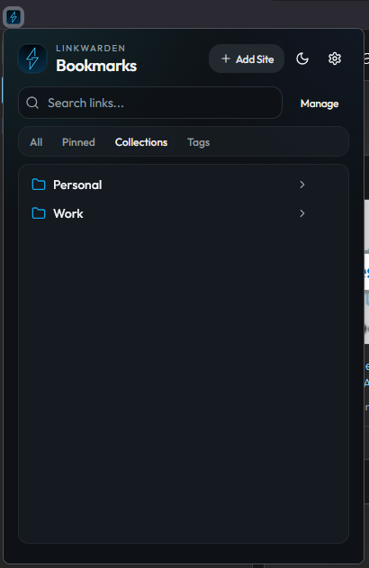

# Linkwarden Browse (SUV)

Browse and save links in your [Linkwarden](https://github.com/linkwarden/linkwarden) collections from a Firefox toolbar popup.

This is a **personal project** (Strictly Using Vibecoding). It is **not** the official [Linkwarden browser extension](https://github.com/linkwarden/browser-extension), is **not affiliated with** Linkwarden, and comes **with no support**. No promises about bugs, updates, or help if something breaks. The code is public in case it is useful to someone else—use it at your own risk.



## Install (Firefox)

1. Download the latest `.xpi` from [Releases](https://github.com/anotgrass/linkwarden-browse-suv/releases).
2. In Firefox open `about:addons` → the gear menu → **Install Add-on From File…** → choose that `.xpi`.
3. Click the toolbar icon → gear (or **Configure**) → a settings **tab** opens → enter your Linkwarden URL and API key → **Save**.

Firefox can auto-update from this GitHub repo after that first install.

| | Official Linkwarden extension | This fork |
| --- | --- | --- |
| Purpose | Save links | Browse collections + save |
| Where to get it | Chrome Web Store / AMO listing | [GitHub Releases](https://github.com/anotgrass/linkwarden-browse-suv/releases) |
| Support | Upstream project | None |

## What it does

- Browse collections with drill-down navigation
- **All** / **Pinned** / **Collections** / **Tags**
- Search links; open them; delete one (⋯) or bulk-delete with checkboxes
- **Add Site** into a collection (same drill-down picker)
- Rename or delete collections in the popup (heavier management stays in the Linkwarden web UI)
- Favicons (optional in settings)
- Right-click: save page or save all tabs
- Address-bar keyword: `lw`

You need your own Linkwarden instance (or cloud account) and an API key.

## Develop (optional)

Only if you want to build from source. Requires **Node.js 20+** and **npm**.

```bash
git clone https://github.com/anotgrass/linkwarden-browse-suv.git
cd linkwarden-browse-suv
npm install
npm run build
```

Load `dist/manifest.json` via `about:debugging` (temporary; gone on restart), or run `npm run dev:firefox`.

```bash
npm run pack:firefox   # zip for AMO upload
npm run sign:firefox   # unlisted sign (WEB_EXT_API_KEY / WEB_EXT_API_SECRET)
npm run lint:firefox
npm run e2e
```

Chromium can load the same `dist/`. Safari: `npm run build:safari` then the Xcode project under `safari/`.

### Publishing a new Firefox build

1. Bump `version` in `manifest.config.ts`.
2. Sign via AMO (**On your own**) or `npm run sign:firefox`.
3. GitHub Release `vX.Y.Z` with `linkwarden-browse-X.Y.Z.xpi`.
4. Append the version in `firefox/updates.json` on `main`.

## License

[MIT](LICENSE) — same as upstream. Copyright (c) 2024 Linkwarden; modifications in this fork Copyright (c) 2026 anotgrass. Keep the license and copyright notices when you redistribute.

## Upstream

Forked from [linkwarden/browser-extension](https://github.com/linkwarden/browser-extension). Do not file issues about this fork on the Linkwarden project.
